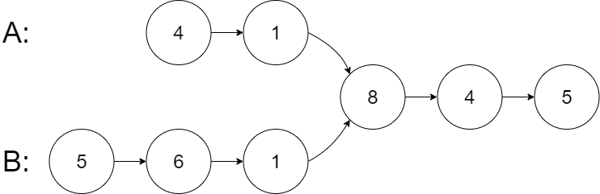

# Linked List Intersection

## Problem Statement

Given the heads of two singly linked-lists `head_a` and `head_b`, return the node at which the two lists intersect. If the two linked lists do not intersect, the function should return `None`.

For example, the following two linked lists begin to intersect at the node containing 8:



Text representation for ChatGPT reviews:
```
A:      4 -> 1 ->
                  8 -> 4 -> 5
B: 5 -> 6 -> 1 ->
```

The following two linked lists do _not_ intersect at all.


Text representation for ChatGPT reviews:
```
A: 2 -> 6 -> 4
                  
B:      1 -> 5
```

For this problem, we want to focus on the nodes themselves and not necessarily the *value* inside of the node.

For example, while the following linked lists have tails that share the same values, they are not considered intersecting because the nodes of the linked lists are not the same nodes in memory.


Text representation for ChatGPT reviews:
```
A: 5 -> 2 -> 4 -> 1

B: 3 -> 8 -> 4 -> 1
```

There are no cycles anywhere in the linked list structures. Assume any intersection includes the tails of each list.

The linked lists must retain their original structure after the function returns.

## Prompts

<!-- prettier-ignore-start -->
### !challenge
* type: paragraph
* id: c273469f-8ac2-4c98-a876-521b74d6e7e0
* title: Describe Your Understanding
* topics: pse
##### !question

Before you begin solving this problem, take a moment to think like a professional software engineer. 
- What do we know about the problem? 
- What assumptions can we make based on the information in the problem statement? 
- What further information do the example inputs and outputs give us?
- What questions would you ask a teammate, product manager, or interviewer to better understand the problem before writing any code?

<br>

In the box below, list 5 or more observations about the problem or questions whose answers would clarify the problem statement. For each observation or question, include information on why that observation is important or why you are asking the question.
- For each observation, answer how that observation will affect your approach to the problem.
- For each question, describe what you are hoping to clarify about the problem and provide an answer which includes the effect your decision would have on how you might approach the problem.

<br>

As you come up with observations and questions, assume that error handling for invalid data is managed outside the function. We want to focus on the core behavior of the function we will write. 

##### !end-question
##### !placeholder

Add observations, assumptions, and questions here:

Eg. from the sample PSE: 
I observe that the function should return a string indicating the result of the game: "Player 1 wins!", "Player 2 wins!", or "It's a tie!"
    - Aside from checking if someone wins, I need to consider the edge case where the players could tie.

##### !end-placeholder
##### !hint

Further questions to ask as you read through the problem statement and examples:
- What is the goal of the function?
- What are the types of the expected inputs and outputs?
- Are there any restrictions on any of the inputs?
  - For example: if any of the inputs are a list, do we know anything about how the list is ordered?
- What do the examples show us about the data types and values that are allowed for our inputs?
- What do the examples tell us about the return value in different scenarios?
- Reflecting on the observations you have made so far, what questions would give you new information?

<br>

Consider the following for inspiration:
- [About PSEs](../about-pses/about-pses.md)
- [Our example PSE with example answers](../about-pses/example-pse.md)
- Previous PSEs

##### !end-hint
##### !explanation

One of many possible responses could look like:

1. What should be returned if one or both lists are empty?
    - If either list is empty there can be no intersection, so by the problem description we should return `None`.

2. Can the lists intersect more than once?
    - The examples do not clarify this, but the problem statement has the line "Assume any intersection includes the tails of each list." Since the tail is the last element of a list I can assume that this means that from the point of intersection the entire rest of the lists will be part of the intersection.

3. Based on the problem statement, I recognize that the data type or types held by the nodes will not impact the implementation. 
    - Because we are only interested in where the nodes intersect in memory, we will not need to examine the held values. 

4. There are no cycles anywhere in the linked list structures
    - This means the solution does not need to worry about detecting cycles to avoid getting stuck in an infinite loop. If I start at the head of one list and keep moving through the pointers from node to node, I will eventaully reach a `None` value for the next node when I reach the end of the list. 

5. The problem statement says "The linked lists must retain their original structure after the function returns."
    - This tells me that however I move through the lists, I should not change the links between the nodes, I should only traverse the nodes to ensure there are no side effects to the function. 

##### !end-explanation
### !end-challenge
<!-- prettier-ignore-end -->

<!-- prettier-ignore-start -->
### !challenge
* type: code-snippet
* language: python3.6
* id: c52a82cc-4062-405a-b475-0f269b8494c0
* title: Write Unit Tests
* topics: pse
##### !question

1. Use the comments provided to write at least two example input/outputs:
    * Consider at least one nominal and one edge case.
    * What is the expected output for the given input?
    * You can use the examples provided in the prompt, or other examples.
2. Write unit tests for `find_intersecting_node` for the nominal and edge cases you identified in the first step.
When naming a test, we want to ensure the name describes the scenario we are testing by including information like the function being tested, inputs, and expected outputs. 
* e.g. from the example PSE: if we wanted to test that the function winner returns a tie when `player_1` and `player_2` have the same value, then we might name the test something like `test_winner_both_inputs_paper_returns_tie`.

*Note: Click the **Run Tests** button to save your tests for instructor feedback. No real tests are actually run again your unit tests.*

##### !end-question
##### !placeholder

```py
# example input 1:
# expected output 1:

# example input 2:
# expected output 2:

def test_nominal_case():
    # ^rename with meaningful test name
    # and complete test implementation below
    pass
    # arrange

    # act

    # assert

def test_edge_case():
    # ^rename with meaningful test name
    # and complete test implementation below
    pass
    
    # arrange
    
    # act
    
    # assert
```
##### !end-placeholder
##### !tests

```py
import unittest

class TestPython1(unittest.TestCase):
  def test_always_pass(self):
    self.assertEqual(1,1)
```

##### !end-tests
##### !explanation 

Example tests:

```python
def test_find_intersecting_node_returns_intersection_for_lists_of_same_length():
    # Arrange
    node_d = Node("D")
    node_x = Node("X")
    node_one = Node("1")
    node_two = Node("2")
    node_three = Node("3")

    node_one.next = node_two
    node_two.next = node_three

    # List A: D -> 1 -> 2 -> 3
    node_d.next = node_one

    # List B: X -> 1 -> 2 -> 3
    node_x.next = node_one

    head_a = node_d
    head_b = node_x

    # Act
    result = find_intersecting_node(head_a, head_b)

    # Assert
    assert result == node_one


def test_find_intersecting_node_returns_none_with_one_empty_list():
    # Arrange
    node_d = Node("D")
    node_e = Node("E")
    node_f = Node("F")

    # List A: D -> E -> F
    node_d.next = node_e
    node_e.next = node_f

    # List B: None, the list is empty

    # Act
    result = find_intersecting_node(node_d, None)

    # Assert
    assert result is None
```

##### !end-explanation
### !end-challenge
<!-- prettier-ignore-end -->

<!-- prettier-ignore-start -->
### !challenge
* type: paragraph
* id: 10510a7b-e915-42cc-8cea-26555f96c34d
* title: Create Logical Steps
* topics: pse
##### !question

Without writing code, describe how you would implement `find_intersecting_node` as if you were talking through the details with another developer who will have to implement the function. We should capture the main use cases, but the steps do not need to be a detailed plan for every contingency. 
* The objective is to practice describing algorithms and technical concepts while creating a roadmap that we can use to keep ourselves oriented towards our goal during the implementation step. 
* It is okay to leave some of the finer details to be worked out in the implementation itself!

As you write your steps, keep the following guidelines in mind:
* We want to think about a general approach rather than what the code would look like line-by-line. 
* It may be helpful to break up the problem/algorithm into smaller subproblems/algorithms. 
    * For example: 1. Handle edge cases, 2. Perform the computation/solve the problem/etc.
* The steps should be a description as if you were talking out the problem with another person and should be agnostic of any particular language. 
    * As such, they should not include code syntax in the description.

What's important at this stage is to think through ahow you would put an approach into words, and outline the implementation before writing code.

##### !end-question
##### !placeholder

Write the logical steps here.

##### !end-placeholder
##### !hint

How do we iterate through a singly linked list?

An intersection isn't guaranteed to be at matching indices in each list, so how can we compare each element in one list to each element in another?

How do we know if two nodes are the same in memory?

##### !end-hint
##### !explanation 

1. If either input list is empty, return `None`
2. Initialize a pointer to the head node of list 1
3. Iterate through the nodes of list 1. For each node in list 1:
    1. Initialize a pointer to the head of list 2
    2. Iterate through the nodes of list 2. For each node in list 2:
        1. Check if the current node of list 1 from the outer loop is the same node in memory as the current node of list 2
            1. If they are the same nodes, return the current node
            2. If they are not the same node, update the list 2 pointer to the next node of list 2 to continue iterating through list 2
    3. Update the list 1 pointer to the next node of list 1 to continue iterating
4. If we reach the end of either list 1 or list 2 and have not returned, then return `None` since there was no intersection 

##### !end-explanation
### !end-challenge
<!-- prettier-ignore-end -->

<!-- prettier-ignore-start -->
### !challenge
* type: paragraph
* id: 2fa7f8df-60ad-43f9-9424-9780a6b6d1e3
* title: Review Logical Steps
* topics: pse
##### !question

We want to know if we are laying out an approach to the coding problem that makes sense for our context and if that approach is clearly conveying our thoughts on technical topics to others. While we build our skills in breaking down and describing algorithms, let’s use an AI tool like ChatGPT to review the Logical Steps we wrote above. Our goals are to check if the steps:
- convey the technical concepts and requirements of the problem in a way that another person can understand
- make sense for the problem being solved
- are not missing important steps or scenarios
- are agnostic of any particular language – the steps should not include code syntax.

<br>

For this question we will:
1. Build a prompt using [the template linked here](https://gist.githubusercontent.com/ada-instructors/670252696f1625cf0ed77c0997cd165d/raw/pse_logical_steps_review_template.md)
2. Share the completed prompt with an AI tool like ChatGPT
3. Reflect on the information shared by the AI tool, then use the prompts below to summarize its findings and your learnings.

<br>

Reflection Prompts

1. Identify one specific strength the AI highlighted in your explanation. 
    * Quote or paraphrase the part of the feedback that mentions this strength, and explain why you think that aspect of your explanation was effective.
2. Point out at least one specific improvement the AI recommended.
    * Describe exactly which part of your explanation would benefit from strengthening then outline how you would revise that part if you were rewriting it now.
3. Identify one piece of AI feedback you believe was inaccurate, irrelevant, or unnecessary. 
    * Explain why it doesn’t apply to this problem, and cite a source (docs, class notes, instructor explanation, or trusted online reference) that supports your reasoning.
4. Describe one change the AI suggested that was new or surprised you. 
    * Share how this suggestion shifted your understanding of the problem or your explanation.

<br>

In the box below, please submit:
1. A shareable link to your conversation in ChatGPT
    - [Documentation for creating a shareable link in ChatGPT](https://help.openai.com/en/articles/7925741-chatgpt-shared-links-faq)
2. Your reflections and summary of the discussion with ChatGPT

##### !end-question
##### !explanation

As an example, let’s say we used logical steps similar to the explanation for the question above in our prompt. Depending on how the supplied steps differ and exactly what ChatGPT shares, a reflection and summary might look like:

<br>

Chat Link: `<url to your conversation>`

<br>

One strength the AI tool pointed out was that my steps correctly compare nodes by identity rather than by value. The feedback noted that I "check if the current node of list 1 from the outer loop is the same node in memory as the current node of list 2" and called this the detail that made the roadmap actually solve the stated problem, since the prompt distinguishes true intersections from lists that merely share equal values. I think this was effective because it shows I read the problem statement carefully rather than defaulting to the more common "equal values" version of this question, and it keeps the roadmap from silently solving the wrong problem.

<br>

One improvement the AI recommended was to make the stopping condition of each loop explicit rather than implied. In my original steps I said to "iterate through the nodes of list 1" and "iterate through the nodes of list 2" without stating what causes each iteration to end. The AI pointed out that in a spoken interview, leaving this implicit can make it sound like I haven't thought through the termination condition, even though I likely have. If I were rewriting my steps, I would state that each loop advances its pointer until it reaches a node whose next value is empty, at which point the loop ends. This revision would make the roadmap self-contained and remove any doubt about how the iteration terminates.

<br>

One piece of feedback I believe was inaccurate was the claim that resetting the list 2 pointer back to the head on every pass through the outer loop was a mistake that would hurt performance and should be removed. Resetting the pointer is not a bug, it is required for the nested-loop approach to work at all, since each node of list 1 needs to be compared against every node of list 2 to check for a shared memory address. The steps in the problem's own explanation describe this exact structure, and removing the reset would mean most nodes of list 1 never get compared against most nodes of list 2, causing valid intersections to be missed. The actual concern worth raising is the resulting time complexity, not the reset itself, so this feedback addressed a problem that does not exist in the intended approach.

<br>

One suggestion that stood out to me was the recommendation to mention the classic technique of aligning the two lists before comparing them, rather than comparing every node of list 1 against every node of list 2. The AI explained that walking each list once to find its length, then advancing the pointer of the longer list by the length difference before stepping through both lists together, would let me find the intersection in a single pass instead of a nested one. This shifted my understanding of the roadmap goal versus the communication goal, since my nested-loop steps are correct and easy to explain, but naming this alternative up front shows an interviewer that I recognize a brute-force solution's limitations even if I choose to implement the simpler version first.

<br>

##### !end-explanation
### !end-challenge
<!-- prettier-ignore-end -->