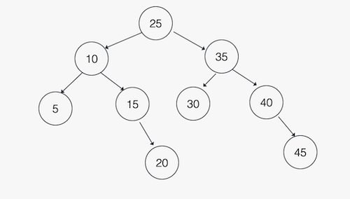

# Array-to-BST

## Problem Statement

Given a sorted array of integers, `arr`, write a function to create a balanced Binary Search Tree from the contents of the array. Return the root of the Binary Search Tree.
* There will not be any duplicate elements in the array
* It is not required to implement a self-balancing Binary Search Tree in order to solve this exercise. For an extra challenge, consider why it is unnecessary!

**Example:**

`arr = [5, 10, 15, 20, 25, 30, 35, 40, 45]`

should result in a tree with the following root/height:



Text representation for ChatGPT review:
```
       25
    /      \
  10        35
 /  \      /  \
5   15    30   40
      \          \
      20         45
```

## Prompts

<!-- prettier-ignore-start -->
### !challenge
* type: paragraph
* id: d0a2663c-8528-41b6-8e21-333812b18876
* title: Describe Your Understanding
* topics: pse
##### !question

Before you begin solving this problem, take a moment to think like a professional software engineer. 
- What do we know about the problem? 
- What assumptions can we make based on the information in the problem statement? 
- What further information do the example inputs and outputs give us?
- What questions would you ask a teammate, product manager, or interviewer to better understand the problem before writing any code?

<br>

In the box below, list 5 or more observations about the problem or questions whose answers would clarify the problem statement. For each observation or question, include information on why that observation is important or why you are asking the question.
- For each observation, answer how that observation will affect your approach to the problem.
- For each question, describe what you are hoping to clarify about the problem and provide an answer which includes the effect your decision would have on how you might approach the problem.

<br>

As you come up with observations and questions, assume that error handling for invalid data is managed outside the function. We want to focus on the core behavior of the function we will write. 

##### !end-question
##### !placeholder

Add observations, assumptions, and questions here:

Eg. from the sample PSE: 
I observe that the function should return a string indicating the result of the game: "Player 1 wins!", "Player 2 wins!", or "It's a tie!"
    - Aside from checking if someone wins, I need to consider the edge case where the players could tie.

##### !end-placeholder
##### !hint

Further questions to ask as you read through the problem statement and examples:
- What is the goal of the function?
- What are the types of the expected inputs and outputs?
- Are there any restrictions on any of the inputs?
  - For example: if any of the inputs are a list, do we know anything about how the list is ordered?
- What do the examples show us about the data types and values that are allowed for our inputs?
- What do the examples tell us about the return value in different scenarios?
- Reflecting on the observations you have made so far, what questions would give you new information?

<br>

Consider the following for inspiration:
- [About PSEs](../about-pses/about-pses.md)
- [Our example PSE with example answers](../about-pses/example-pse.md)
- Previous PSEs

##### !end-hint
##### !explanation

One of many possible responses could look like:

1. The problem statement says we will receive an array of integers as the input.
    - Since we need to create a tree out of the contents of the array, I know the final BST I create will contain those same integer values.

2. The problem statement says the input `arr` will be sorted
    - This is useful, if the array is already sorted, then we know the element at the middle of the list should become the head of the resulting BST. 

3. Is the input always sorted in ascending order?
    - The problem statement does not guarantee this and we only have one example. This would affect how we build the tree, if the input were  always ascending, then I know the elements to the left of the center of the list will form the left branch of the BST and the elements to the right of the center will form the right branch of the BST. For now I will assume always ascending input.

4. I see in the notes of the problem description that there will be no duplicate values in the input list.
    - This simplifies the implementation because it means that we will not need to consider strategies for adding multiple nodes with the same value or implementing something like a counter for nodes to track how many we have of a given value. 

5. Is the array guaranteed to be non-empty?
    - The problem statement does not guarantee that we will not receive a valid but empty list. In this case there are no elements to add to the resulting BST and I will return `None`

##### !end-explanation
### !end-challenge
<!-- prettier-ignore-end -->

<!-- prettier-ignore-start -->
### !challenge
* type: code-snippet
* language: python3.6
* id: 275e4d6e-accf-4dd3-89c4-9f23729615e8
* title: Write Unit Tests
* topics: pse
##### !question

1. Use the comments provided to write at least two example input/outputs:
    * Consider at least one nominal and one edge case.
    * What is the expected output for the given input?
    * You can use the examples provided in the prompt, or other examples.
2. Write unit tests for `arr_to_bst` for the nominal and edge cases you identified in the first step.

When naming a test, we want to ensure the name describes the scenario we are testing by including information like the function being tested, inputs, and expected outputs. 
* e.g. from the example PSE: if we wanted to test that the function winner returns a tie when `player_1` and `player_2` have the same value, then we might name the test something like `test_winner_both_inputs_paper_returns_tie`.

To assist with testing `arr_to_bst`, you can assume that you have access to the following functions:
- `is_bst(root)` - returns whether the tree with the given root is a valid BST
- `is_balanced(root)` - returns whether the tree with the given root is height balanced

*Note: Click the **Run Tests** button to save your tests for instructor feedback. No real tests are actually run again your unit tests.*

##### !end-question
##### !placeholder

```py
# example input 1:
# expected output 1:

# example input 2:
# expected output 2:

def test_nominal_case():
    # ^rename with meaningful test name
    # and complete test implementation below
    pass
    # arrange

    # act

    # assert


def test_edge_case():
    # ^rename with meaningful test name
    # and complete test implementation below
    pass
    
    # arrange
    
    # act
    
    # assert


# Returns True if the BST provided is a valid BST.
def is_bst(root):
    if root is None:
        return True

    left = root.left
    if left is not None and root.val <= left.val:
        return False

    right = root.right
    if right is not None and root.val >= right.val:
        return False

    return is_bst(left) and is_bst(right)


# Returns the height of a tree
def height(root):
    if root is None:
        return 0
    
    left_height = height(root.left)
    right_height = height(root.right)

    if left_height > right_height:
        return left_height + 1
    else:
        return right_height + 1


# Returns True if a tree is balanced
def is_balanced_tree(root):
    if root is None:
        return True

    left_height = height(root.left)
    right_height = height(root.right)

    if abs(left_height - right_height) > 1:
        return False

    left_check = is_balanced_tree(root.left)
    right_check = is_balanced_tree(root.right)

    return left_check and right_check
```
##### !end-placeholder
##### !tests

```py
import unittest

class TestPython1(unittest.TestCase):        
    def test_always_pass(self):
        self.assertEqual(1,1)
```

##### !end-tests
##### !explanation 

Example tests:

```python
def test_arr_to_bst_returns_balanced_bst_for_odd_length_list():
        # Arrange
        arr = [5, 10, 15, 20, 25, 30, 35, 40, 45]

        # Act
        result = arr_to_bst(arr)

        # Assert
        assert result.val == 25
        assert is_bst(result)
        assert is_balanced_tree(result)


def test_arr_to_bst_returns_none_for_empty_list():
        # Arrange
        arr = []

        # Act
        result = arr_to_bst(arr)

        # Assert
        assert result is None
```

##### !end-explanation
### !end-challenge
<!-- prettier-ignore-end -->

<!-- prettier-ignore-start -->
### !challenge
* type: paragraph
* id: eeadcbbb-7fda-4fac-8ef2-309bf97d7245
* title: Create Logical Steps
* topics: pse
##### !question

Without writing code, describe how you would implement `arr_to_bst` as if you were talking through the details with another developer who will have to implement the function. We should capture the main use cases, but the steps do not need to be a detailed plan for every contingency. 
* The objective is to practice describing algorithms and technical concepts while creating a roadmap that we can use to keep ourselves oriented towards our goal during the implementation step.
* It is okay to leave some of the finer details to be worked out in the implementation itself!

As you write your steps, keep the following guidelines in mind:
* We want to think about a general approach rather than what the code would look like line-by-line. 
* It may be helpful to break up the problem/algorithm into smaller subproblems/algorithms. 
    * For example: 1. Handle edge cases, 2. Perform the computation/solve the problem/etc.
* The steps should be a description as if you were talking out the problem with another person and should be agnostic of any particular language. 
    * As such, they should not include code syntax in the description.

What's important at this stage is to think through how you would put an approach into words, and outline the implementation before writing code.

##### !end-question
##### !placeholder

Write the logical steps here.

##### !end-placeholder
##### !explanation 

Example steps:

1. If the input `arr` is empty, return `None`.
2. Find the middle element of `arr`. 
3. Create a node holding the value at the middle of `arr`, this is the head of the BST
4. To create the left and right branches of the BST:
    - Left: 
        1. Create a list containing all the values in `arr` that are smaller than our `head`'s value, maintaining their sorted order. 
        2. Assign the left node of the new BST head to the result of recursively calling `arr_to_bst` passing in the list created in the previous step for the input `arr`. 
    - Right:
        1. Create a list containing all the values in `arr` that are larger than our `head`'s value, maintaining their sorted order.
        2. Assign the right node of the new BST head to the result of recursively calling `arr_to_bst` passing in the list created in the previous step for the input `arr`.
5. Return the new head node.

##### !end-explanation
### !end-challenge
<!-- prettier-ignore-end -->

<!-- prettier-ignore-start -->
### !challenge
* type: paragraph
* id: 59b49996-4089-419d-91c1-4a0192ecbc60
* title: Review Logical Steps
* topics: pse
##### !question

We want to know if we are laying out an approach to the coding problem that makes sense for our context and if that approach is clearly conveying our thoughts on technical topics to others. While we build our skills in breaking down and describing algorithms, let's use an AI tool like ChatGPT to review the Logical Steps we wrote above. Our goals are to check if the steps:
- convey the technical concepts and requirements of the problem in a way that another person can understand
- make sense for the problem being solved
- are not missing important steps or scenarios
- are agnostic of any particular language – the steps should not include code syntax.

<br>

For this question we will:
1. Build a prompt using [the template linked here](https://gist.githubusercontent.com/ada-instructors/670252696f1625cf0ed77c0997cd165d/raw/pse_logical_steps_review_template.md)
2. Share the completed prompt with an AI tool like ChatGPT
3. Reflect on the information shared by the AI tool, then use the prompts below to summarize its findings and your learnings.

<br>

Reflection Prompts

1. Identify one specific strength the AI highlighted in your explanation. 
    * Quote or paraphrase the part of the feedback that mentions this strength, and explain why you think that aspect of your explanation was effective.
2. Point out at least one specific improvement the AI recommended.
    * Describe exactly which part of your explanation would benefit from strengthening then outline how you would revise that part if you were rewriting it now.
3. Identify one piece of AI feedback you believe was inaccurate, irrelevant, or unnecessary. 
    * Explain why it doesn't apply to this problem, and cite a source (docs, class notes, instructor explanation, or trusted online reference) that supports your reasoning.
4. Describe one change the AI suggested that was new or surprised you. 
    * Share how this suggestion shifted your understanding of the problem or your explanation.

<br>

In the box below, please submit:
1. A shareable link to your conversation in ChatGPT
    - [Documentation for creating a shareable link in ChatGPT](https://help.openai.com/en/articles/7925741-chatgpt-shared-links-faq)
2. Your reflections and summary of the discussion with ChatGPT

##### !end-question
##### !explanation

As an example, let’s say we used logical steps similar to the explanation for the question above in our prompt. Depending on how the supplied steps differ and exactly what ChatGPT shares, a reflection and summary might look like:

<br>

Chat Link: `<url to your conversation>`

<br>

The feedback noted that starting with the base case (an empty array) and then defining what happens on each recursive branch makes it easy for another developer to follow how the tree gets built layer by layer. I think this was effective because it shows I understood the recursive structure before describing the surrounding details.

<br>

One improvement the AI recommended was to be more explicit about how the left and right sublists are constructed relative to the middle element, rather than only saying they contain the "smaller" and "larger" values. If I were rewriting my steps, I would clarify that because the input is already sorted, the left sublist is simply every value before the middle index and the right sublist is every value after it, so there is no need to compare each value against the head's value one at a time.

<br>

A piece of feedback I believe was inaccurate or unnecessary was the suggestion that my steps needed an explicit description of how the recursion terminates. My first step already defines the base case: if the input is empty, return `None`. Since every recursive call operates on a strictly smaller sublist, the recursion is guaranteed to reach that base case, so I don't think a separate step was necessary here.

<br>

The only suggestion that surprised me was the recommendation to explain why using the middle of a sorted array, rather than the first or last element, is what keeps the resulting tree balanced. I had taken this for granted, but explaining it out loud forced me to think more precisely about the relationship between array indices and tree height, and it connects directly to the note in the problem statement about why a self-balancing tree isn't necessary here.

##### !end-explanation
### !end-challenge
<!-- prettier-ignore-end -->